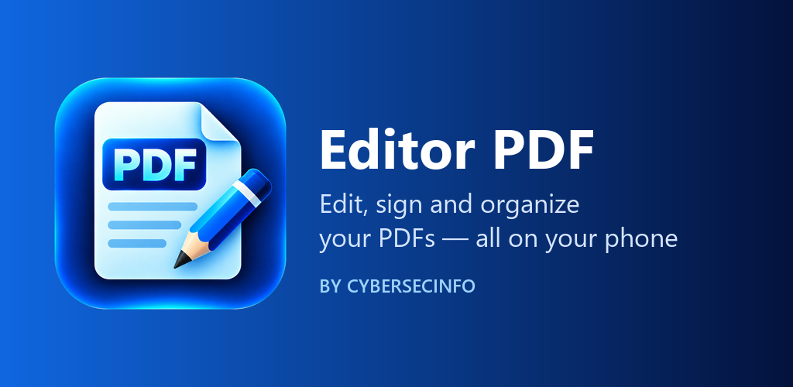
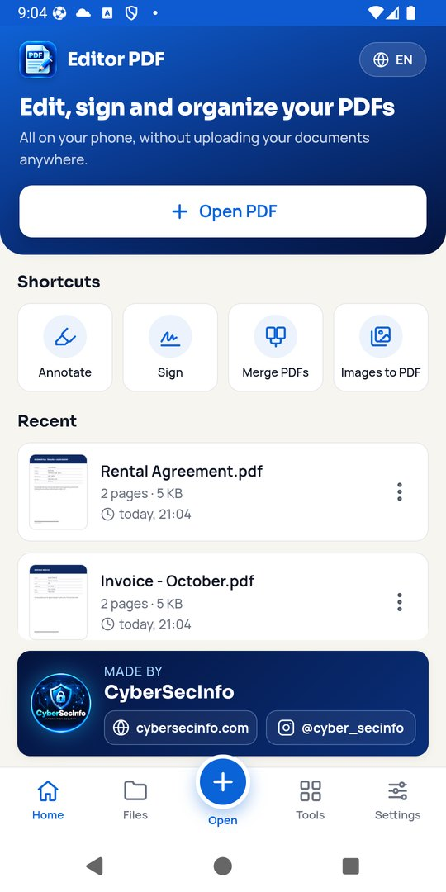
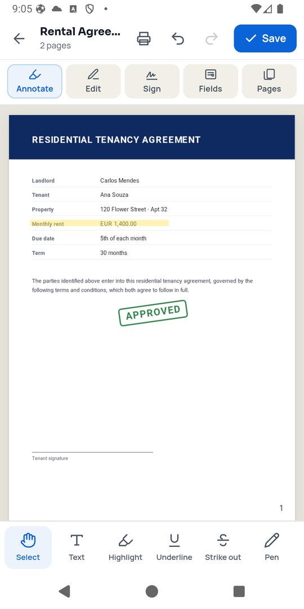
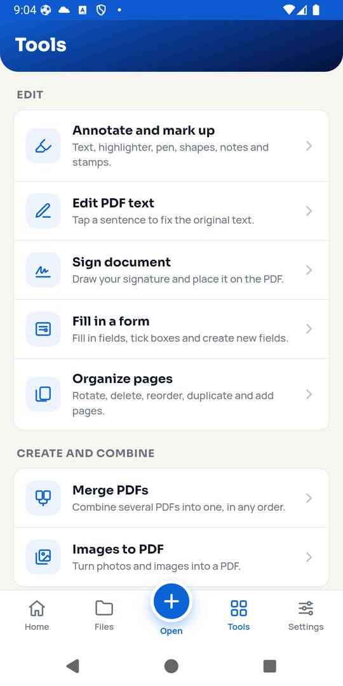

<p align="center"></p>

# Editor PDF

A complete PDF editor for **Android, iPhone, Windows, macOS and Linux** that works entirely on your device. No account, no ads, no tracking and no uploads — documents never leave the device.

**Download:** [cybersecinfo.com/editor-pdf](https://cybersecinfo.com/editor-pdf/) · Coming soon to Google Play and the App Store · [Privacy policy](https://cybersecinfo.com/editor-pdf/privacy/)

<p align="center">
  
  
  
</p>

## Features

| | |
|---|---|
| **Edit** | Edit the original text of a PDF (keeps colour and weight), add text and images |
| **Annotate** | Highlighter, underline, strike-through, pen, shapes, arrows, sticky notes, stamps |
| **Sign & fill** | Draw and reuse a signature, fill PDF forms, create new form fields |
| **Protect** | True redaction (content is removed from the file, not just covered), AES-256 passwords and permissions, remove passwords, strip metadata |
| **Optimize** | Compress PDFs, OCR scanned documents (English and Portuguese) into searchable PDFs |
| **Convert** | PDF to Word (.docx), images and text, PDF/A for archiving, images to PDF |
| **Pages** | Merge, split, extract, rotate, reorder, duplicate, insert blank pages, watermarks, page numbers, headers and footers, compare two PDFs |
| **Output** | Print and share from the app |

The interface is available in English and Portuguese.

## How it is built

- **Desktop** (`main.js`, `app/`): Electron. The heavy lifting runs in a worker thread (`engine/`).
- **Mobile** (`mobile/`): Capacitor app for Android and iOS. It runs **the same engine** (`engine/ops.mjs`) inside a Web Worker, so every platform gets identical results.
- **Engine**: [MuPDF](https://mupdf.com/) (WebAssembly) for redaction, compression, rendering, structured text, PDF/A and encryption; [Tesseract.js](https://github.com/naptha/tesseract.js) for OCR; [docx](https://github.com/dolanmiu/docx) for Word export.
- **Editing layer**: [pdf.js](https://mozilla.github.io/pdf.js/) for rendering, [Fabric.js](http://fabricjs.com/) for annotations, [pdf-lib](https://pdf-lib.js.org/) for writing the final PDF.
- **Native bits**: a small Capacitor plugin (`mobile/plugins/print`) for system printing on Android and iOS.

Nothing is fetched from the internet at runtime: OCR language data, fonts and the WebAssembly modules ship with the app.

## Building

```bash
# Desktop
npm ci
node scripts/prepare-vendor.mjs   # OCR language data
npm start                         # run
npm run selftest                  # end-to-end tests (71 checks, incl. veraPDF for PDF/A)

# Mobile
cd mobile
npm ci
npm run build && npx cap sync
cd android && ./gradlew assembleDebug        # Android APK
# iOS: open mobile/ios/App/App.xcodeproj in Xcode
```

Installers for Windows, macOS and Linux and the iOS build are produced by GitHub Actions (`.github/workflows`).

## License

Editor PDF is released under the **GNU Affero General Public License v3.0** (see [LICENSE](LICENSE)), because it includes MuPDF, which is licensed under AGPL-3.0.

Third-party components: MuPDF (AGPL-3.0), pdf.js (Apache-2.0), Tesseract.js (Apache-2.0), pdf-lib (MIT), Fabric.js (MIT), docx (MIT), Electron (MIT), Capacitor (MIT). OCR training data from tessdata (Apache-2.0). Fonts: Liberation Sans (SIL OFL 1.1), Manrope and Sora (SIL OFL 1.1).

---

Made by **[CyberSecInfo](https://cybersecinfo.com/)** — Information Security · [@cyber_secinfo](https://www.instagram.com/cyber_secinfo/)
